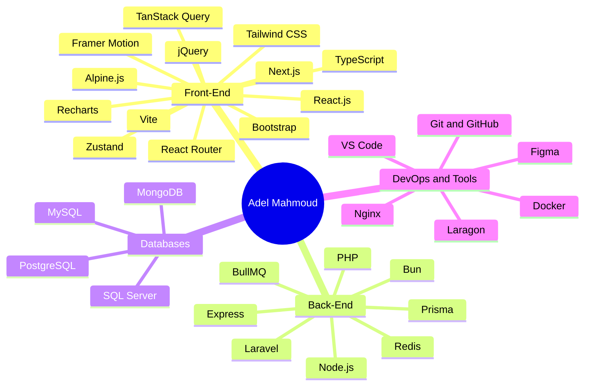

### 👋 Hi, I'm Adel Mahmoud

**Senior Front-End Developer · Junior Back-End Developer · Full Stack Developer**

---

## 🎯 About

- 💻 **Full Stack Developer** with a primary focus on **Front-End** (Senior level) and hands-on **Back-End** experience (Junior level).
- 🎨 I care about clean, fast, and user-friendly interfaces with maintainable code.
- 🌱 Currently deepening my skills in building complete applications end to end.
- 🤝 Open to Front-End roles and Full Stack projects.

---

## 💼 Experience

**Front-End Developer & Project Reviewer · ERC** (Dec 2024 – Mar 2025)
- Built and maintained responsive websites using React.js.
- Collaborated with UI/UX designers and back-end developers.
- Reviewed and improved front-end code for multiple student projects.

**Front-End Developer · Codexa** (Nov 2025 – Present)

**3+ years Front-End · 1+ year Back-End**

- 🧑‍💼 **20+ clients** served
- 🚀 **30+ projects** delivered

---

## 📅 Skill Development Journey

| Timeline | Technology Focus | Proficiency Level |
|---|---|---|
| **2023** · Foundation | HTML, CSS | Advanced ⭐⭐⭐⭐⭐ |
| **2023–2024** · Leadership | Git, GitHub, VS Code, Postman | Expert Leader ⭐⭐⭐⭐⭐⭐⭐⭐ |
| **2024** · Programming | C++ | Beginner ⭐⭐⭐ |
| **2024–2025** · Enterprise | Python, MySQL, PostgreSQL | — |
| **2025–2026** · Full-Stack | PHP, Laravel, Vue, React, Node.js | Advanced ⭐⭐⭐⭐⭐ |

---

## 🌐 Languages

- Arabic: **Native**
- English: **Professional**

---

## 🧠 Skills

### 🖥️ Backend Excellence

   

### 🎨 Frontend Mastery

     

### 🗄️ Databases & Infrastructure

 

### 🧰 Development Tools

    

### 🗺️ Technology Proficiency Matrix

<!-- Edit these lists to match your real stack -->

---

## 🚀 Featured Projects

### 🧩 Full Stack Projects

| Project | Description | Stack |
|---|---|---|
| **Onsyntax** | [PLACEHOLDER: one-line description] | Laravel · React 19 · Vite · Tailwind CSS 4 · TanStack Query · React Router 7 · i18next · Axios · ESLint |
| **Ninjaco** | [PLACEHOLDER: one-line description] | [PLACEHOLDER] |
| **LMS Dashboard and Website** | [PLACEHOLDER: one-line description] | [PLACEHOLDER] |
| **Codexa** | [PLACEHOLDER: one-line description] | [PLACEHOLDER] |
| **Leap** | [PLACEHOLDER: one-line description] | React 19 · TanStack Start · TanStack Router · TanStack Query · TanStack Form · Tailwind CSS 4 · Vite · TypeScript · Zod · Firebase · LiveKit · Cloudflare Workers · Playwright · Biome · Bun |
| **Coach Adel** | [PLACEHOLDER: one-line description] | Laravel · React 19 · Vite · Tailwind CSS 4 · React Router · Framer Motion · i18next · Recharts · Axios |
| [**Laurz Lab**](https://github.com/3adel-sw/front-laurus-lab) | [PLACEHOLDER: one-line description] | React · Vite · Tailwind CSS 4 · React Router · TanStack Query · React Hook Form · Zod · Zustand · i18next · Vitest · Playwright |
| **Ayman Portfolio** | [PLACEHOLDER: one-line description] | Laravel · Vite · Tailwind CSS 3 · Alpine.js · Axios · PostCSS |
| **Barcody** | [PLACEHOLDER: one-line description] | Laravel · React 19 · Vite · Tailwind CSS 4 · React Router · Axios · react-datepicker · react-international-phone |

<!-- Add each project's repo or live link once confirmed -->

### 🎨 Front-End Practice

| Project | Description | Stack |
|---|---|---|
| [make-a-image-editor-using-javascript](https://github.com/3adel-sw/make-a-image-editor-using-javascript) | Browser-based image editor |  |
| [Profile-HTML-CSS](https://github.com/3adel-sw/Profile-HTML-CSS) | Personal profile page |   |
| [Website-Iphone-13Pro-Max](https://github.com/3adel-sw/Website-Iphone-13Pro-Max) | Product landing page |   |
| [project-5-BootStrap-5](https://github.com/3adel-sw/porject-5-BootStrap-5) | Bootstrap 5 project |  |

---

## 📈 GitHub Stats

  
  

---

## 📫 Get in Touch

  
  
  
  

  
  

---

⭐ If you like a project, drop a star!

